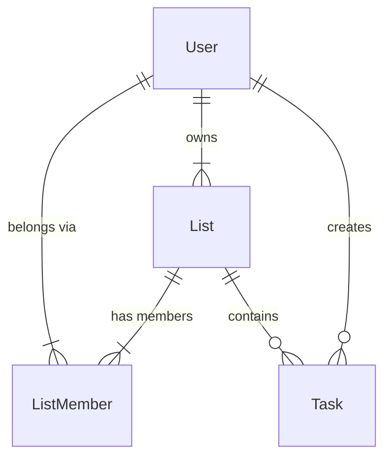

# USAD

**One step at a time.**
*Matatapos din 'yan.*

USAD is a simple, personal task management web application, helping users keep track of what they need to do and stay organized. Each user signs up, logs in, and manages their own tasks in a private personal list, or works together with other users in shared (collaborative) lists.

## Live App

| Part | Host | URL |
| --- | --- | --- |
| Frontend | Render Static Site | `https://cmsc128-usad.onrender.com/` |
| Backend (API) | Render Web Service | `https://usad-j5vo.onrender.com` |
| Database | Turso (hosted SQLite/libSQL) | not public |

### How to access it

1. Open the backend URL once (`https://usad-j5vo.onrender.com`). It should say `Lista API is running!`.
2. Open the frontend URL and register an account, or log in.

**Cold start warning:** Render's free web service sleeps when idle. The first request after a pause can take about a minute. Opening the backend URL first wakes it up. No installation or setup is needed on your end. A browser on any device or network works.

### Architecture

```
Browser --> Render Static Site (HTML/CSS/JS)
        --> Render Web Service (Node/Express API) --> Turso (hosted libSQL)
```

- The frontend calls the API with `fetch(..., { credentials: "include" })`.
- The backend reads its Turso URL and token from environment variables.
- Because the two sites are on different domains, the session cookie is `secure` and `sameSite: none` in production, and CORS only allows `FRONTEND_URL`.

## Tech Stack

### Frontend
- HTML, CSS, JavaScript (no framework)
- [flatpickr](https://flatpickr.js.org/) for the date picker

### Backend
- Node.js, Express.js
- `cookie-session` for sessions, `bcrypt` for password hashing

### Database
- Turso (hosted libSQL/SQLite) through `@libsql/client`

### Why these technologies?
HTML, CSS, and JavaScript keep the frontend lightweight and easy to host as a static site. Node.js and Express provide a simple REST API. SQLite's SQL model fits our small, relational data (users, lists, memberships, tasks). Turso hosts SQLite remotely, so data persists independently of the backend server. This matters on Render's free tier, where the web service's disk does not persist. `@libsql/client` lets the Node backend talk to Turso.

## Current Features
**Tasks**
- Add, edit, delete, and complete tasks
- Quick add: type a title in the sticky note and press Enter. Press `N` anywhere to jump to it
- Side panel for adding and editing tasks, with a date picker and quick dates (Today, Tomorrow, Next week, No date)
- Delete has an **Undo** toast (no confirmation dialog)
- Filter by status, category, and priority
- Sort by date added, due date, priority, and category by clicking the column headers
- "Overdue" for tasks that are not completed past due date
- Toasts for success and error feedback, with a Retry action when a list fails to load
- Inline field validation messages

**Accounts and Authentication**
- Sign up with a username, display name, and password (validated, passwords hashed)
- Log in, log out, and stay logged in after a refresh or server restart
- Profile page where the user can view and change their username, display name, and password
- All account, profile, and task routes are protected on the server

**Collaborative To-Do Lists**
- Every user has a private **Personal list** (created automatically on sign up)
- Create **shared lists** and switch between lists from the sidebar
- The list owner can add users by username and remove anyone in the list
- Members can leave a shared list, and the owner can delete it (both ask for confirmation)
- Users only see the lists they own or were added to
- Tasks in shared lists show who added them, with a "(left)" marker if that person is no longer a member
- Member avatar stack and a members panel
- Only the person who added a task or the list owner can delete or restore it

**UX**
- Responsive layout: on small screens the sidebar becomes a bottom bar and the lists become a dropdown
- Loading, empty, and failed states on the task list
- Keyboard support: Esc closes the panel, focus returns to where it was

## How Activity 1 and Activity 2 were merged

- **Activity 1 (CRUD tasks):** Developed through seperate feature branches, with the last, completed `feat/ui` branch merged into `main`. Activity 1 provided task creation, viewing, updating, deletion, filtering, sorting, and undo delete.
- **Activity 2 (registration and login):** Developed on the `act2-accounts` branch, as instructed, and was merged into `main`. Activity 2 added user registration, login, user profile, session management, and password hashing.
- **Merge strategy** Activity 1's feature branches were merged into `main`, with `feat/ui` as the final feature branch merged. The `act2-accounts` branch, which built upon Activity 1's existing implementation, was subsequently merged into `main`. Then, `act3-ubac` branch was created from the updated `main` branch to implement user-based access control.
- **What changed to integrate them:**
    - Added a `user_id` column to the `Task` table to associate each task with its owner.
    - Updated task queries to retrieve and modify only tasks belonging to the authenticated user.
    - Protected task routes using the `requireAuth` middleware.
    - Redirected users to their To-Do List after successful login.
    - Centralized frontend API requests through `apiFetch()`, which includes session credentials and handles `401 Unauthorized` responses by returning users to the login screen.
- **Conflicts resolved:** No merge conflicts occurred during integration.


## What Was Refactored and Why (Activity 4)

**Backend / database**
- **Transactions:** creating a list and its owner's membership, and deleting a list with its tasks and members, each run in one `db.batch`, so they fully succeed or fully fail.
- **Ownership checks inside the query** for routes that only have a task id (edit, done), so a user cannot touch a task outside their lists (no IDOR).
- **`cookie-session`** replaced the session table, so no session lookup is needed on every request.
- Secrets are read from environment variables only. `.env` is in `.gitignore`.
- Deployed the frontend as a Render Static Site and the backend as a Render Web Service.
- Updated the frontend API URL to point to the deployed backend.
- Configured CORS to allow communication between the frontend and backend.
- Configured the backend to connect to the hosted Turso database using environment variables, keeping database credentials out of the source code.


**UX/UI**
- Consistent feedback for every action (toasts, inline errors, disabled and "Saving..." buttons).
- Labeled icon buttons, contrast-checked colors, and a responsive layout.
- Updated the interface with a notebook-inspired aesthetic to create a more familiar, approachable, and organized task-management experience. The design reinforces the app's productivity theme while making task management feel more personal and less overwhelming.
- One side panel pattern is reused for the task form and the members list.


## How to Run Locally

### Prerequisites
- Node.js and npm
- A [Turso](https://turso.tech/) account and the Turso CLI
- VS Code with the Live Server extension

1. Clone the repository
```bash
git clone https://github.com/rskaindoy/cmsc128-Lab1_CRUD_Kaindoy.git
cd cmsc128-Lab1_CRUD_Kaindoy
```

2. Create a Turso database and token (use a separate database for local testing)
```bash
turso db create usad-local
turso db show usad-local --url
turso db tokens create usad-local
```

3. Create the tables
```bash
turso db shell usad-local < backend/schema.sql
```

4. Install the backend dependencies
```bash
cd backend
npm install
```

5. Create your `.env` file (the server won't start without it)
```bash
cp .env.example .env
```
Fill in the values from the table below. Generate a session secret with:
```bash
node -e "console.log(require('crypto').randomBytes(32).toString('hex'))"
```

6. Start the backend (from the `backend` folder)
```bash
npm start
```
It runs at `http://localhost:3000`.

7. Point the frontend at your local backend. In `frontend/auth.js`, use the localhost line:
```js
const API_URL = "http://127.0.0.1:3000/api";
// const API_URL = "https://usad-j5vo.onrender.com/api";
```

8. Open `frontend/index.html` with Live Server. Use `http://127.0.0.1:5500`, not `localhost`, because the backend only accepts requests from that origin (CORS).

## Environment Variables

Set these in `backend/.env` locally and in the **Render dashboard** (Environment tab) for the deployed Web Service. They are never committed to GitHub. `backend/.env.example` lists the names only.

| Variable | Purpose |
| --- | --- |
| `TURSO_DATABASE_URL` | Turso database URL (`libsql://...`) |
| `TURSO_AUTH_TOKEN` | Turso auth token |
| `SESSION_SECRET` | Key used to sign the session cookie |
| `FRONTEND_URL` | Allowed CORS origin (the Static Site URL) |
| `NODE_ENV` | Set to `production` on Render: enables `secure` and `sameSite: none` cookies |

The server exits on startup if `TURSO_DATABASE_URL`, `TURSO_AUTH_TOKEN`, or `SESSION_SECRET` is missing.

## Deployment (Render + Turso)

1. **Database:** create a Turso database, run `backend/schema.sql` against it, and create an auth token.
2. **Backend:** on Render, create a **Web Service** from this repo.
   - Root directory: `backend`
   - Build command: `npm install`
   - Start command: `npm start`
   - Add the environment variables above.
3. **Frontend:** on Render, create a **Static Site** from this repo.
   - Publish directory: `frontend`
   - No build command.
4. Set `API_URL` in `frontend/auth.js` to the backend URL, and set `FRONTEND_URL` on the backend to the Static Site URL.

If the laptop is off, the app still works: the frontend, API, and database all run on hosted services.

## Database
### Setup
The tables are **not** created automatically. Apply `backend/schema.sql` to your Turso database (see step 3 above). It uses `CREATE TABLE IF NOT EXISTS`, so it is safe to re-run, but it never alters existing tables. To change the schema, edit the table in the Turso shell or recreate the database.

Inspect data with `turso db shell <db-name>` or the Turso dashboard. `pw_hash` holds a bcrypt hash that starts with `$2b$10$`, never the real password.

### Schema
| Table | Purpose |
| --- | --- |
| `User` | `user_id`, `username` (unique), `display_name`, `pw_hash`, `created_at` |
| `Task` | `task_id`, `user_id` (FK to `User`, the creator), `list_id` (FK to `List`), `title`, `due`, `priority`, `tag`, `is_done`, `created_at`, `deleted_at` |
| `List` | `list_id`, `name`, `owner_id` (FK to `User`), `type` (`personal` or `collab`), `created_at` |
| `ListMember` | `list_id` + `user_id` (composite primary key, both foreign keys), `added_at` |

### How the entities relate


- A user owns at least one list (their personal list) and can own any number of shared lists. Each list has exactly one owner.
- A user has at least one membership record (the owner is a member of their own lists). Each membership record belongs to exactly one user.
- A list has at least one membership record (its owner). Each membership record belongs to exactly one list.
- A list contains zero or many tasks. Each task belongs to exactly one list.
- A user creates zero or many tasks. Each task is created by exactly one user.

Other notes:
- Personal lists can't be shared or deleted.
- `ListMember` only says who is allowed to access a list.
- `List.owner_id` records who **owns** a list.
- `Task.user_id` records who **created** the task. Access to a task is decided by membership in the task's list.
- Tasks are soft-deleted (`deleted_at`), which is what makes Undo possible.
- The schema is normalized: a task stores `user_id`, not the user's name. The name comes from a join.

## API Endpoints

All routes start with `/api`. Requests and responses are JSON. Routes marked *login required* return `401` without a valid session cookie.

**Authentication**

| Method | Route | Description |
| --- | --- | --- |
| POST | `/auth/register` | Create an account, create the Personal list, and log in |
| POST | `/auth/login` | Log in |
| GET | `/auth/me` | Current user (used to restore the session) |
| POST | `/auth/logout` | Clear the session cookie |

**Profile** (login required)

| Method | Route | Description |
| --- | --- | --- |
| GET | `/profile` | Get username, display name and created date |
| PUT | `/profile` | Update username and display name |
| PUT | `/profile/password` | Change password (needs the current password) |

**Lists and members** (login required)

| Method | Route | Who may call it |
| --- | --- | --- |
| GET | `/lists` | Any user. Returns only their lists, with `role` and `member_count` |
| POST | `/lists` | Any user. Create a shared list they own |
| PUT | `/lists/:listId` | Owner only. Rename (API only, no UI) |
| DELETE | `/lists/:listId` | Owner only. Not allowed for Personal lists |
| GET | `/lists/:listId/members` | Members of the list |
| POST | `/lists/:listId/members` | Owner only. Not allowed for Personal lists |
| DELETE | `/lists/:listId/members/:userId` | Owner removes a member, or a member leaves. The owner can't be removed |

**Tasks** (login required)

| Method | Route | Description / ownership check |
| --- | --- | --- |
| GET | `/lists/:listId/tasks` | List tasks. User must be a member. Each task includes `added_by`, `is_member` and `can_delete` |
| POST | `/lists/:listId/tasks` | Create a task. User must be a member |
| PUT | `/tasks/:id` | Edit a task. The task's list must be one the user belongs to |
| PUT | `/tasks/:id/done` | Mark done or not done. Same membership check |
| DELETE | `/tasks/:id` | Soft delete. Only the task's creator or the list owner |
| PUT | `/tasks/:id/restore` | Undo a delete. Only the task's creator or the list owner |

Validation rules:
- Usernames are 3-20 characters (letters, numbers, underscores).
- Display names are up to 50 characters.
- Passwords are at least 8 and at most 72 bytes.
- List names are required, up to 50 characters.
- Task titles are required, up to 255 characters. Priority must be Low, Medium, or High. Category must be School, Personal, or Others. Due date must be a valid date (or empty).

## How Ownership Is Checked

Every check happens on the server. Hiding buttons in the page is only a convenience.

1. **Logged in?** `requireAuth` checks the session. No session means `401`.
2. **Member of the list?** For `/lists/:listId/...` routes, `requireMember` looks for a row joining `List` and `ListMember` for this list id and the logged-in user. No row means `404` (not `403`, so list ids can't be probed).
3. **Owner?** Owner-only routes also run `requireOwner`, which compares `List.owner_id` with the logged-in user. Not the owner means `403`.
4. **Routes that only have a task id** put the check inside the query itself:

```sql
UPDATE Task
SET title = ?, due = ?, priority = ?, tag = ?
WHERE task_id = ?
AND deleted_at IS NULL
AND list_id IN (SELECT list_id FROM ListMember WHERE user_id = ?)
```

If the task is not in one of the user's lists, no row changes and the API answers `404`.

5. **Delete and restore** also require that the user created the task or owns its list, otherwise `403`.

## How Sessions Work

1. On login or registration the server stores `userId` in a session using `cookie-session`.
2. The session lives in a **signed cookie** named `usad_session`, not in a database. The signature uses `SESSION_SECRET`, so the browser can't change it. The cookie is `httpOnly`, so JavaScript can't read it.
3. The cookie lasts 24 hours. The user stays logged in after a refresh or a backend restart, because the session is in the cookie, not in server memory.
4. In production the cookie is `secure` and `sameSite: none`, because the frontend and backend are on different Render domains. The backend also sets `trust proxy`, because Render sits behind a proxy.
5. When the page loads, the frontend calls `GET /api/auth/me` to restore the logged-in state.
6. If the cookie is missing or expired, protected routes answer `401` and `apiFetch()` sends the user back to the login screen.
7. Logging out sets `req.session = null`, which clears the cookie.

## Screenshots

- Login page


- Register page


- Dashboard (Personal list)


- Quick add and the Add task side panel


- Editing a task


- Delete with Undo toast


- Filters and sorting


- Shared list


- Members panel


- Profile page


