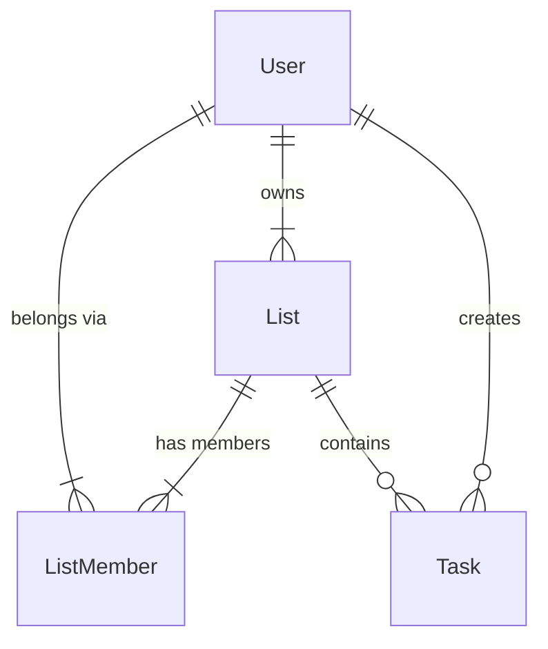

USAD

**One step at a time.**
*Matatapos din 'yan.*

USAD is a simple, personal task management web application, helping users keep track of what they need to do and stay organized. Each user signs up, logs in, and manages their own tasks in a private personal list, or works together with other users in shared (collaborative) lists.

## Tech Stack

### Frontend
- HTML
- CSS
- JavaScript

### Backend
- Node.js
- Express.js

### Database
- SQLite through `better-sqlite3` (`lista.db`)

### Why these technologies?
I chose HTML, CSS, and JavaScript for the frontend because they are lightweight and straightforward for building the application's user interface. Node.js and Express.js are used for the backend as they allow us to create a simple REST API for handling task operations. SQLite was chosen as the database because it is lightweight, easy to set up locally, and does not require a separate database server. `better-sqlite3` provides a simple way for the Node.js backend to interact with the SQLite database.

## Current Features
**Tasks**
- Add, edit, delete (with confirmation and undo), and complete tasks
- Filter tasks by status, category, and priority (Low/Medium/High)
- Sort tasks by date added, due date, priority, and category
- Overdue badge
- Persistent task storage using SQLite

**Accounts and Authentication**
- Sign up with a username, display name, and password (validated, passwords hashed)
- Log in, log out, and stay logged in after a refresh or server restart
- Profile page where user can view and change their username, display name, and password
- All account, profile, and task routes are protected on the server

**Collaborative To-Do Lists**
- Every user has a private **Personal list** (created automatically on sign up)
- Create **shared lists** and switch between your Personal list and shared lists from the sidebar
- The list owner can add other users by username and remove anyone in the list
- Members can leave a shared list, and the owner can delete it
- Users only see the lists they own or were added to
- Tasks in shared lists show who added them

## How Activity 1 and Activity 2 were merged

- **Activity 1 (CRUD tasks):** Developed through seperate feature branches, with the last, completed `feat/ui` branch merged into `main`. Activity 1 provided task creation, viewing, updating, deletion, filtering, sorting, and undo delete.
- **Activity 2 (registration and login):** Developed on the `act2-accounts` branch, as instructed, and was merged into `main`. Activity 2 added user registration, login, user profile, session management, and password hashing.
- **Merge strategy** Activity 1's feature branches were merged into `main`, with `feat/ui` as the final feature branch merged. The `act2-accounts` branch, which built upon Activity 1's existing implementation, was subsequently merged into `main`. Then, `act3-ubac` branch was created from the updated `main` branch to implement user-based access control.
- **What changed to integrate them:**
    - Added a `user_id` column to the `Task` table to associate each task with its owner.
    - Updated task queries to retrieve and modify only tasks belonging to the authenticated user.
    - Protected task routes using the `requireAuth` middleware.
    - Redirected users to their To-Do List after successful login.
    - Centralized frontend API requests through `apiFetch()`, which includes session credentials and handles `401 Unauthorized` responses by returning users to the login screen.
- **Conflicts resolved:** No merge conflicts occurred during integration.

## How to Run Locally

### Prerequisites

Make sure you have:
- Node.js installed
- npm installed
- VS Code with Live Server and SQLite Viewer extensions

1. Clone the Repository
```bash
git clone https://github.com/rskaindoy/cmsc128-Lab1_CRUD_Kaindoy.git
cd cmsc128-Lab1_CRUD_Kaindoy
```

2. Install the backend dependencies
```bash
cd backend
npm install
```

3. Create your `.env` file (the server won't start without it):
```bash
cp .env.example .env
```
Open `.env` and replace `change-me` with a long random secret. You can generate one with:
```bash
node -e "console.log(require('crypto').randomBytes(32).toString('hex'))"
```
`.env` is listed in `.gitignore`, so your secret stays on your machine.

4. Start the backend server (from the `backend` folder):
```bash
npm start
```
It runs at `http://localhost:3000`.

5. Start the frontend. Open `index.html` with Live Server. Use the address`http://127.0.0.1:5500`, not `localhost`, because the backend only accepts requests from that origin (CORS).

## Database setup
There is nothing to run by hand. `database.js` creates `lista.db` and its tables the first time the server starts.

### Schema
| Table | Purpose |
| --- | --- |
| `User` | `user_id`, `username` (unique), `display_name`, `pw_hash`, `created_at` |
| `Task` | `task_id`, `user_id` (FK to `User`, the creator), `list_id` (FK to `List`), `title`, `due`, `priority`, `tag`, `is_done`, `created_at`, `deleted_at` |
| `List` | `list_id`, `name`, `owner_id` (FK to `User`), `type` (`personal` or `collab`), `created_at` |
| `ListMember` | `list_id` + `user_id` (composite primary key, both foreign keys), `added_at` |

Sessions live in a separate file, `sessions.db`, managed by `connect-sqlite3`.

### How the entities relate


- A user owns at least one list (their personal list) and can own any number of shared lists. Each list has exactly one owner.
- A user has at least one membership record (the owner is a member of their own lists). Each membership record belongs to exactly one user.
- A list has at least one membership record (its owner). Each membership record belongs to exactly one list.
- A list contains zero or many tasks. Each task belongs to exactly one list.
- A user creates zero or many tasks. Each task is created by exactly one user.

Other Notes:
- Each user has exactly one `personal` list (enforced by a unique index). Personal lists can't be shared or deleted.
- `ListMember` only says who is allowed to access a list
- `List.owner_id` records who **owns** a list
- `Task.user_id` records who **created** the task. Access to a task is decided by membership in the task's list.
- The schema is normalized.

### Seeder

The project includes a seeder that populates `lista.db` with sample users, lists, and tasks for testing and demonstration. By default, it adds the sample records to the existing database without clearing or replacing existing users or tasks, so it is safe to run more than once. 

Run these commands from the project root:
```bash
cd backend
npm run seed            # add sample data
node seed.js --reset    # delete existing users, lists, and tasks, then reseed
```
Warning: --reset deletes existing database records. Use it only when you want to start fresh with sample data.

Sample logins (password: `password123`):

| User | Sees |
| --- | --- |
| `nikko` | My Tasks, Nikko's Group List |
| `victor` | My Tasks, Victor's Group List, Nikko's Group List (added by Nikko) |
| `bea` | My Tasks only (used to test that access is denied) |

Tables are created with `CREATE TABLE IF NOT EXISTS`, so they are never changed once they exist. After pulling a schema change, stop the server, delete `lista.db` and `sessions.db`, then start it again.

To inspect the data, open `lista.db` with `SQLite Viewer` extension in VSCode. `pw_hash` holds a bcrypt hash that starts with `$2b$10$`, never the real password. The `.db` files are listed in `.gitignore`.

## API endpoints

All routes start with `/api`. Requests and responses are JSON. Routes marked *login required* return `401` without a valid session cookie.

**Authentication**

| Method | Route | Description |
| --- | --- | --- |
| POST | `/auth/register` | Create an account, create the Personal list, and log in |
| POST | `/auth/login` | Log in |
| GET | `/auth/me` | Current user (used to restore the session) |
| POST | `/auth/logout` | Destroy the session |

**Profile** (login required)

| Method | Route | Description |
| --- | --- | --- |
| GET | `/profile` | Get username, display name and created date |
| PUT | `/profile` | Update username and display name |
| PUT | `/profile/password` | Change password (needs the current password) |

**Lists and members** (login required)
| Method | Route | Who may call it |
| --- | --- | --- |
| GET | `/lists` | Any user. Returns only the lists they are a member of |
| POST | `/lists` | Any user. Create a shared list they own |
| PUT | `/lists/:listId` | Owner only. Rename |
| DELETE | `/lists/:listId` | Owner only. Not allowed for Personal lists |
| GET | `/lists/:listId/members` | Members of the list |
| POST | `/lists/:listId/members` | Owner only. Not allowed for Personal lists |
| DELETE | `/lists/:listId/members/:userId` | Owner removes a member, or a member leaves. The owner can't be removed |


**Tasks** (login required)

| Method | Route | Description / Ownership check|
| --- | --- | --- |
| GET | `/lists/:listId/tasks` | List tasks. User must be a member of the list |
| POST | `/lists/:listId/tasks` | Create a task. User must be a member of the list |
| PUT | `/tasks/:id` | Edit a task. The task's list must be one the user belongs to |
| PUT | `/tasks/:id/done` | Mark done or not done |
| DELETE | `/tasks/:id` | Delete a task (soft delete) |
| PUT | `/tasks/:id/restore` | Undo a delete |

Validation rules: 
- Usernames are 3-20 characters (letters, numbers, underscores)
- Display names are up to 50 characters
- Passwords are at least 8 and at most 72 characters.
- List names are required, up to 50 characters.
- Task titles are required, up to 255 characters; priority must be Low, Medium, or High; category must be School, Personal, or Others; due date must be a valid date (or empty).

To run the validator tests: `cd backend && npm test`.

## How Ownership is checked

Every check happens on the server. Hiding buttons in the page is only a convenience.

1. **Logged in?** `requireAuth` checks the session. No sesssion means `401`.
2. **Member of the list?** For `lists/:listId/...` routes, `requireMember` looks for a row joining `List` and `ListMember` for this list id and the logged-in user's id. No row means `404`.
3. **Owner?** Owner-only routes also run `requireOwner`, which compares `List.owner_id` with the logged-in user's id. Not the owner means `403`.
4. **Routes that only have a task id** put the check inside the query itself:

```sql
UPDATE Task
SET title = ?, due = ?, priority = ?, tag = ?
WHERE task_id = ?
AND list_id IN (SELECT list_id FROM ListMember WHERE user_id = ?)
```

If the task is not in one of the user's lists, no row changes and the API answers `404`.


## How sessions work

1. On login or registration the server stores `userId` in a server-side session.
2. The session is saved in `sessions.db` (SQLite). The browser only receives a cookie (`connect.sid`) containing the session ID, never the user's data.
3. The cookie lasts 24 hours. Because the session is in a database, the user stays logged in after a page refresh, after using the back/forward buttons, and after a backend restart.
4. When the page loads, the frontend calls `GET /api/auth/me` to restore the logged-in state.
5. If the session expires or is lost, protected routes answer `401` and the frontend sends the user back to the login screen. Logging out destroys the session on the server and clears the cookie. Protected routes use a `requireAuth` middleware, so the API refuses requests after logout.

## Screenshots
Dashboard of User 1 (Personal List)


Adding a Task


Editing a Task


Deleting a Task (Confirmation Pop-up)


Working Filter System


Profile Page


Shared List of User 1 


Members List Panel


View of User 2 (Not in User 1's Shared List)


